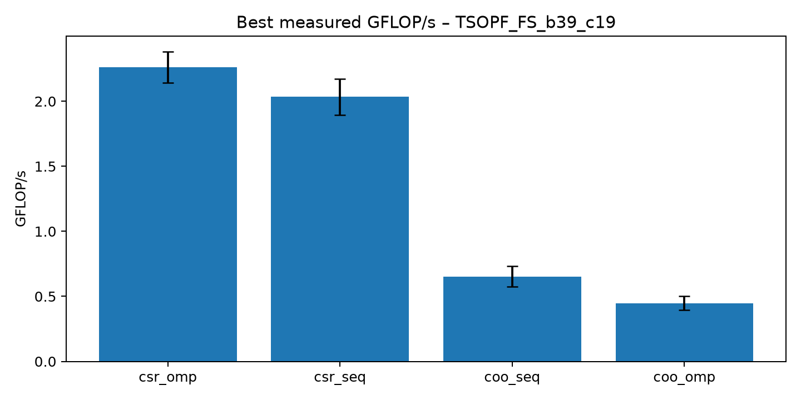
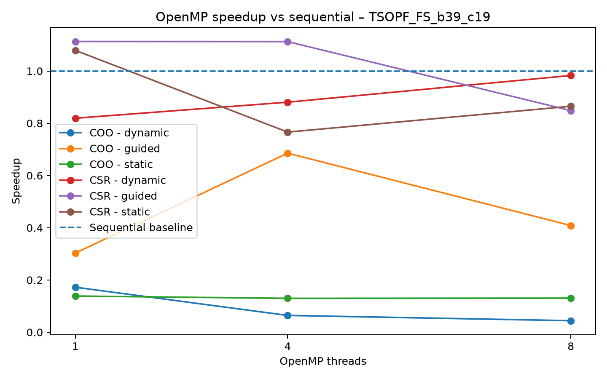
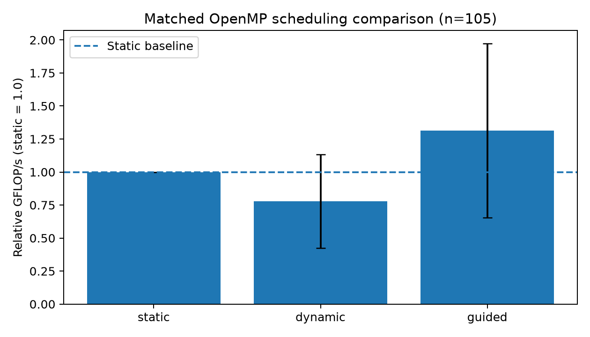
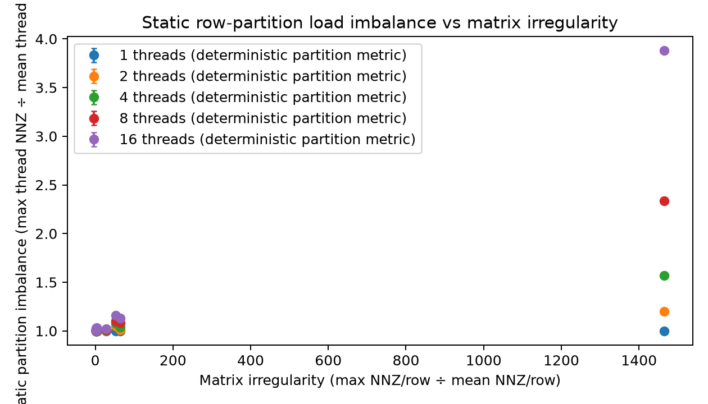
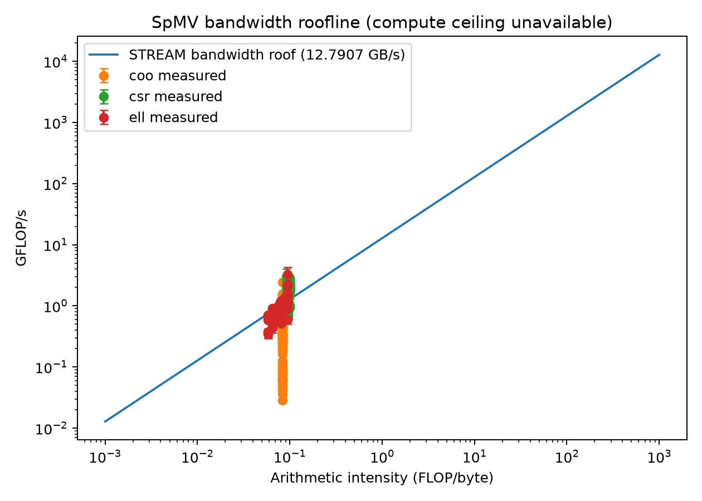

# Parallel Sparse Matrix–Vector Multiplication on a Multicore CPU
**Team 5 | Cluster B | Problem 5**

## 1. Objective

The objective was to implement and evaluate sparse matrix–vector multiplication (SpMV) using COO, CSR and ELL storage formats on a multicore CPU. Sequential and OpenMP implementations were compared across SuiteSparse matrices. The study examined scheduling policies, thread scaling, row-length irregularity, first-touch initialization, thread binding and memory-bandwidth limits.

## 2. Experimental setup

| Item | Configuration |
|---|---|
| CPU | Intel Core i5-1235U |
| Cores / logical processors | 10 / 12 |
| Cache | L2: 6656 KB; L3: 12288 KB |
| RAM | 16 GiB |
| OS | Windows 11 Home, 64-bit |
| Compiler | GCC 16.2.0, MSYS2 UCRT64 |
| OpenMP | `_OPENMP=202111` (OpenMP 5.2) |
| Build flags | `-O3 -fopenmp -Wall -Wextra` |
| Precision | Double precision |
| Threads | 1, 4 and 8 |
| Schedules | Static, dynamic and guided; chunk size 16 |
| Repetitions | 1 warm-up and 5 measured runs |

Thirteen SuiteSparse matrices were evaluated: appu, uni_chimera_i4, soc-sign-Slashdot090221, wy2010, mixtank_new, Goodwin_071, bbmat, ns3Da, sparsine, bcsstk35, av41092, TSOPF_FS_b39_c19 and qpband. Matrix Market inputs and deterministic saved vectors were used. The selected matrices include graph, CFD, structural, power-network, large and structured sparse cases.

STREAM used 50,000,000 elements per array and 10 timing iterations. Validation passed. The highest measured Triad bandwidth was **12.7907 GB/s at 6 threads**. This is measured bandwidth, not theoretical peak bandwidth.

## 3. Methodology

Matrix Market inputs were converted to COO, CSR and ELL representations. Correctness was checked against an independent reference implementation that traverses the original COO entries directly. This reference is separate from the CSR kernel and is used to check the sequential and OpenMP format implementations.

The independent-reference validation completed **140 checks with 140 passes and zero failures**. It covered sequential COO and CSR and their OpenMP static, dynamic and guided configurations for all 13 matrices. ELL was validated for the nine matrices whose padding ratio was at or below the configured threshold of 20; ELL was excluded for the other four matrices.

This validation was performed separately from the historical benchmark run. The existing raw benchmark CSV was preserved and contains 2,100 rows: 350 configurations with six observations each, including the warm-up. Its historical error values were produced before the independent reference was added; the separate 140-check validation should not be interpreted as a rerun or revalidation of every historical timing record. Processed summaries exclude warm-up observations.

SpMV performs approximately two floating-point operations per nonzero. COO parallel accumulation uses atomic updates because multiple nonzeros can contribute to the same output row. CSR and ELL use row-based OpenMP parallelism.

Static, dynamic and guided schedules were tested. The scheduling-comparison plot uses matched configurations and normalizes throughput to the static schedule, rather than pooling unmatched configurations into a single raw mean.

ELL stores rows at a common width, so short rows can require padding up to the longest row. ELL was excluded for four matrices when the padding ratio exceeded 20.

## 4. Results

### Format performance

| Implementation | Mean GFLOP/s |
|---|---:|
| COO sequential | 1.2882 |
| COO OpenMP | 0.3072 |
| CSR sequential | 1.7972 |
| CSR OpenMP | 1.8731 |
| ELL sequential | 0.9937 |
| ELL OpenMP | 0.9192 |

CSR achieved the highest average throughput. OpenMP slightly improved the aggregate CSR mean, while the aggregate COO and ELL OpenMP means were lower than their sequential counterparts. The highest individual configuration was qpband ELL sequential at 3.2901 GFLOP/s. These averages combine different matrices and configurations and should not be interpreted as a controlled single-matrix comparison.

### Thread scaling

Per-matrix speedup was calculated against the sequential baseline for the same format. Scaling was not linear: the aggregate mean throughput across OpenMP configurations was 0.9241 GFLOP/s at one thread, 1.0819 GFLOP/s at four threads and 1.1326 GFLOP/s at eight threads.

### Scheduling

The matched scheduling comparison evaluates static, dynamic and guided scheduling on the same matrix, format, thread-count, chunk-size and binding configurations. Throughput is normalized against static scheduling (static = 1.0). This avoids interpreting a pooled average across unmatched workloads as a controlled scheduling comparison. The resulting plot summarizes the relative performance of the three policies across the matched configurations.

### Row-length irregularity and load balance

The ratio of maximum to mean nonzeros per row was used as a simple irregularity indicator. TSOPF_FS_b39_c19 had a ratio of approximately 1465.43, compared with approximately 1.81 for sparsine.

The load-imbalance metadata estimates work assigned by OpenMP `schedule(static,16)` using cyclic chunks of 16 rows. For each thread count, row chunks are assigned in the same round-robin order as this static scheduling policy, and the metric is the maximum estimated per-thread nonzero count divided by the mean per-thread count. This is an analytical workload estimate, not a measurement of runtime or elapsed-time imbalance. It applies to row-based CSR and ELL scheduling; COO parallelizes nonzero iterations and therefore has a different work-distribution behavior.

### Roofline and memory bandwidth

The roofline figure uses the measured STREAM Triad bandwidth of 12.7907 GB/s. Arithmetic intensity is estimated using two FLOPs per nonzero and the following approximate bytes-per-nonzero model:

- COO: 24 bytes per nonzero (row index, column index, value and input-vector element).
- CSR: `20 + 4R/N` bytes per nonzero, where `R` is the number of rows and `N` is the number of nonzeros (value, column index, input-vector element and amortized row-pointer traffic).
- ELL: `16 + 4P` bytes per nonzero, where `P` is the ELL padding ratio (column-index traffic for padded slots, plus value and input-vector traffic for valid nonzeros).

These are simplified traffic estimates, not measured DRAM transactions. They omit output-vector traffic, COO atomic read-modify-write effects, cache reuse and other hardware-specific effects. In particular, the ELL estimate accounts for column-index checks across padded slots while counting value and input-vector accesses for valid nonzeros. A compute ceiling is not shown because a defensible FP64 peak estimate was not established; this is therefore a bandwidth-only roofline.

## 5. Discussion

CSR was the strongest overall format in the measured averages. Its row-oriented structure avoids COO's atomic accumulation overhead and avoids ELL's fixed-width padding. COO is straightforward to store, but atomic updates can limit parallel performance. ELL can be effective when row lengths are similar; it is less suitable when a small number of rows are much longer than the rest.

The matched scheduling plot compares policies on equivalent configurations. The best schedule can still depend on matrix structure and format. Increasing the thread count improved aggregate throughput only modestly, indicating that parallel overhead and irregular memory access limit scaling.

Parallel first-touch initialization reduced initialization time in the recorded 50-million-element tests at 2–12 threads. For example, at four threads the measured time decreased from 98 ms to 61 ms. These measurements do not establish NUMA locality because the machine's NUMA topology and memory placement were not verified.

Thread binding was attempted on sparsine and TSOPF_FS_b39_c19. The GCC `libgomp` runtime reported “Affinity not supported on this configuration” when binding was enabled. Successful processor pinning was therefore not established, and no pinning benefit is claimed.

## 6. Conclusion and limitations

Sequential and OpenMP COO, CSR and ELL implementations were evaluated across 13 SuiteSparse matrices. Independent-reference correctness validation passed 140 checks: COO and CSR were checked on all 13 matrices, while ELL was checked on the nine matrices meeting the padding threshold. The historical 2,100-row benchmark CSV was preserved and was not rerun as part of this validation.

CSR achieved the highest aggregate mean throughput. The matched scheduling comparison evaluates static, dynamic and guided policies on equivalent configurations. Performance varied with matrix structure and row-length distribution; additional threads did not produce linear scaling.

Limitations include unsupported thread affinity in the tested Windows runtime, unverified NUMA topology, simplified byte-traffic estimates, no established FP64 compute ceiling and no power measurements. The load-imbalance plot is an analytical estimate for row-based static chunk-16 scheduling rather than a runtime measurement. ELL was excluded for four matrices because their padding ratio exceeded the configured threshold.
